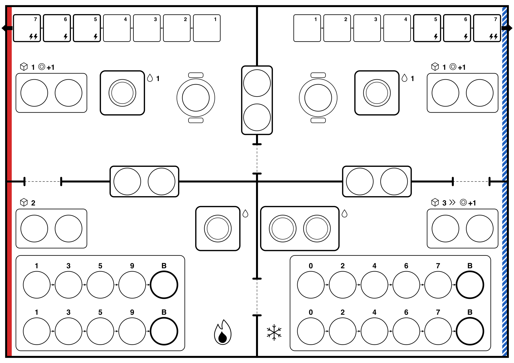
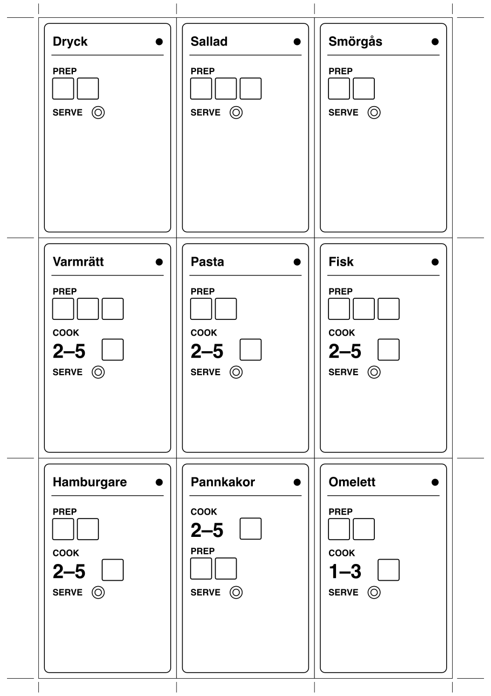
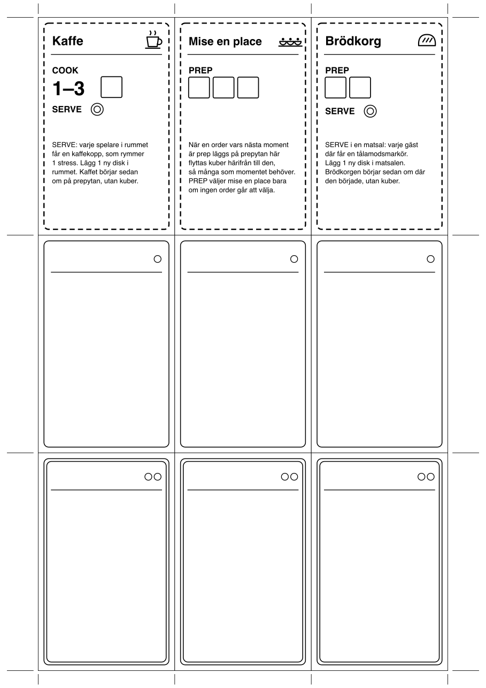
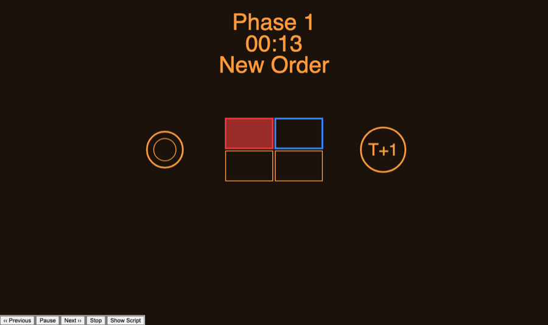

# Kitchen Alert – regler

*Speltestversion 2026-10-11*

[English version](rules.md)

Kitchen Alert är ett samarbetsspel byggt på Space Alert. Fyra spelare, eller fem, driver en restaurang under en service. Som i Space Alert planerar ni i realtid till ett ljudspår och spelar sedan upp planen runda för runda. I stället för hot kommer det in ordrar, och i stället för skada får ni stress.

Reglerna förutsätter att ni kan Space Alert. Det som fungerar likadant står bara kort.

## Material

- Spelplanen: [`print/board.pdf`](print/board.pdf), A3.
- Orderkort: 12 vanliga och 6 stora, [`print/orderkort-1.pdf`](print/orderkort-1.pdf) och [`print/orderkort-2.pdf`](print/orderkort-2.pdf). Klipp ut dem och lägg dem i plastfickor framför Space Alerts hotkort.
- Specialkort och tomma kort för egna ordrar: [`print/specialkort.pdf`](print/specialkort.pdf).
- Handlingskort, spelartavlor och figurer från Space Alert (se [Kortleken](#kortleken)).
- Markörer för varje runda 1–8, numrerade med rundan:
  - 1 kortbricka, som ligger på orderkortet. Den behöver ingen baksida.
  - 1 ordermarkör, som visar var ordern är. Disk på baksidan.
  - 1 gästmarkör, som går på gästbanan. Disk på baksidan.
  - 3 fokusmarkörer, som läggs på handlingskort. Disk på baksidan.

  Markörerna blir lättare att hålla isär om sorterna ser olika ut, till exempel i form eller färg. Planen är ritad för markörer på ungefär 20 mm.
- 8 lösa diskbrickor.
- Prepkuber (runt 20) och stresskuber i en annan färg (runt 20).
- Tålamodsmarkörer, runt 10.
- 3 överskottsplatser per spelare, till exempel tre rutor på en lapp bredvid tavlan.
- Med specialkort: en markör för varje specialkort och några kaffekoppar.
- Servicespelaren (se [Servicespelaren](#servicespelaren)) eller en utskriven service.

## Spelplanen

Planen har fyra rum. Matsalarna ligger i norr och köken i söder. Röda sidan är till vänster och blåa sidan till höger, som zonerna i Space Alert:

| | Röda sidan | Blåa sidan |
| --- | --- | --- |
| Norr | Röda matsalen | Blåa matsalen |
| Söder | Varma köket | Kalla köket |

Planen har inga ord. Så här läses den:

- **Dörrar:** en mellan matsalarna, en mellan köken och en mellan kök och matsal på varje sida.
- **Luckan** på varje sida ligger över väggen mellan kök och matsal och hör till båda rummen. **Bardisken** ligger över väggen mellan matsalarna och hör till båda matsalarna.
- **Platser:** varje enkel cirkel rymmer en ordermarkör eller en diskstapel. Prepytorna, luckorna och bardisken har två platser var. Varje matsal har ett bord med en plats.
- **Diskplatser:** dubbla ringar rymmer bara disk. Diskmaskinen i Kalla köket har två staplar. Diskhon i Varma köket och vasken i varje matsal har en stapel.
- **Droppe:** här kan man diska. Står det 1 vid droppen diskas 1 disk per CLEAN, annars allt.
- **Spisen** i varje kök har två banor, en per platta. Siffrorna är spisens värme, och B är kol. Varma köket har den snabba spisen och Kalla köket den långsamma.
- **Gästbanan** i varje matsal har ruta 1–7. En blixt är 1 stress, och pilen ut genom väggen betyder att gästen går.
- **Stationernas symboler** står ovanför prepytorna. Kuben med siffra är antal kuber per PREP, » betyder överspill och tallriken +1 betyder 1 ny disk per PREP.
- **Låga och snöflinga** visar vilket kök som är Varma och vilket som är Kalla.

## Orderkorten

Varje order har sina moment uppifrån och ner. PREP har en ruta per kub som behövs. COOK har ett värmeintervall och en ruta för kuben som visar att tillagningen är gjord. STIR betyder att någon ska röra om, och har också en ruta för en kub. Sist kommer SERVE. En vanlig order har en prick och enkel ram, en stor har två prickar och dubbel ram. Ett timglas längst ner betyder att gästen får en tålamodsmarkör när ordern kommer in. Varje stor order har ett timglas.

## Förberedelser

1. Lägg ut spelplanen och ställ alla figurer i Kalla köket.
2. Blanda de vanliga och de stora orderkorten i var sin hög.
3. Lägg gärna ett eller två specialkort vid ett kök, med sina markörer på prepytan där (se [Specialkort](#specialkort)).
4. Blanda handlingskorten. Varje spelare drar 5 kort till första fasen.
5. Sortera markörerna efter nummer. Lägg diskbrickor, prepkuber, stresskuber och tålamodsmarkörer i förrådet.
6. Starta en service i servicespelaren.

## Planeringen

Planeringen fungerar som i Space Alert. Ni lägger kort på era tavlor i realtid medan ljudspåret spelar. Varje kort används antingen som handling eller som förflyttning. En runda utan kort är en rast. När en ny fas börjar drar varje spelare 5 kort, och kort som blir över sparas.

Ljudspåret ropar ut:

- **Order**, till exempel *Time T plus three. New order. Red dining room.* Laget bestämmer vem som drar det översta kortet ur rätt hög: *New order* är en vanlig order och *Large order* en stor. Den spelaren lägger rundans gästmarkör på ruta 1 på gästbanan i matsalen som ropades ut. Sedan lägger spelaren orderkortet vid ett av de fyra rummen, där ordern startar, med rundans kortbricka på, och tar rundans fokusmarkörer. Den som håller orderkortet får inte lägga eller flytta handlingskort förrän kortet ligger vid ett rum, och kortet får inte flyttas sedan. Ordermarkören läggs på prepytan när ordern kommer in, men den får gärna läggas där redan nu.
- **Delivery:** varje spelare får dra ett kort.
- **Handover:** varje spelare får ge ett kort till en annan spelare innan det piper.
- **Rush hour:** ingen får prata förrän *Rush is over*.
- **Fasslut** som i Space Alert. Sista fasen slutar med *The kitchen is closed*.

### Markörer på korten

Den som har en fokusmarkör kan lägga den på ett kort på sin tavla eller ge den till en annan spelare. Den som håller en markör i handen får inte lägga eller flytta kort förrän markören ligger på ett av ens egna kort i den här fasen eller är tillbakalämnad.

En markör på ett kort ändrar kortet så här:

| Kort | Med ordersidan upp | Med disksidan upp |
| --- | --- | --- |
| PREP | Välj den ordern. | Ingen effekt. |
| COOK/SERVE | Välj den ordern. | Ingen effekt. |
| MOVE | Bär ordern. | Bär disk. |
| CLEAN | Ingen effekt. | Ingen effekt. |

## Utförandet

När sista fasen är slut spelas rundorna 1–12 upp en i taget. Varje runda har fem steg:

1. **Nya ordrar.** Har en order sin runda nu kommer den in. Lägg dess ordermarkör på prepytan i rummet där orderkortet ligger, om den inte redan ligger där, och en tålamodsmarkör på gästmarkören för varje timglas på orderkortet.
2. **Handlingar.** Varje spelare gör handlingen på sitt kort för rundan, i spelordning.
3. **Spisarna.** Varje order på en spis flyttar ett steg.
4. **Gästerna.** Varje gästmarkör flyttar ett steg.
5. **Stress.** Stressen i varje rum delas ut.

### Ordrar

- En order *är i* ett rum när dess ordermarkör ligger på en yta som hör till rummet. En order i luckan är alltså i både köket och matsalen.
- Ett moment är *gjort* när det har alla sina kuber. Orderns *nästa moment* är det första som inte är gjort.
- Kan en handling välja mellan flera ordrar väljs den med lägst nummer. En fokusmarkör med ordersidan upp på kortet väljer i stället den ordern, om den går att välja.
- **Fullt med ordrar:** ska en order läggas på en yta där alla platser har ordrar läggs den där ändå, som en extra order. Det kostar 1 stress.

### PREP

Välj en order i rummet vars nästa moment är prep. En order på spisen går att välja bara om dess tillagning är klar. Finns ingen händer inget.

1. Flytta ordern till rummets prepyta.
2. Lägg kuber på momentet: 3 i Kalla köket, 2 i Varma köket och 1 i matsalarna. Lägg aldrig fler än momentet behöver. När momentet har alla sina kuber är det gjort.
3. Bara i Kalla köket: kuber som blir över går till nästa order i rummet som går att välja, på samma sätt.
4. I Kalla köket och i matsalarna: lägg 1 ny disk i rummet.

### COOK/SERVE

Välj en order i rummet som något av följande gäller för, och gör det som står:

- **Klar på spisen:** lyft av ordern. Är nästa moment prep läggs den på prepytan. Är det servering görs det som står för servering nedan.
- **Ska röras om:** nästa moment är STIR. Lägg en kub på STIR och gör sedan det som momentet därefter säger. Är det en tillagning läggs ordern på första rutan på en platta: samma platta om den redan står på spisen, och annars en ledig. Är det prep läggs den på prepytan, och är det servering görs det som står för servering nedan.
- **Ska tillagas:** ordern ligger på prepytan i ett kök, nästa moment är tillagning och en platta är ledig. Lägg ordern på spisens första ruta.
- **Ska serveras och gästen sitter här:** ställ ordern på bordet. Står det disk där flyttas den disken som ny disk i matsalen, och det kostar 1 stress. Vänd sedan ordermarkören och gästmarkören, som nu är två disk i en stapel på bordet. Lägg orderkortet bland de serverade.
- **Ska serveras och gästen sitter någon annanstans:** flytta ordern en serveringsyta mot gästen. Från ett kök går den till luckan på samma sida och från en matsal till bardisken. En order som redan ligger på den ytan går inte att välja.

Finns ingen sådan order och du står i en matsal lugnar du gästen med lägst nummer där: lägg en tålamodsmarkör på gästmarkören. Annars händer inget.

Med en fokusmarkör på kortet går det också att välja en order på spisen som inte är klar. Den flyttas till prepytan utan kub.

### CLEAN

- **Kök:** fyll diskmaskinen i Kalla köket eller diskhon i Varma köket med disk från rummets andra platser, mest störande först. Ta sedan bort all disk i maskinen eller hon.
- **Matsal:** fyll vasken med disk från rummets andra platser, mest störande först. Ta sedan bort 1 disk ur vasken.

Borttagen disk går tillbaka: lösa diskbrickor till förrådet och markörer till sin hög.

### Disken

- En stapel rymmer 3 disk. Diskmaskinen rymmer alltså 6 och diskhon och vasken 3.
- Varje rum har sina platser i en fast ordning, från minst till mest störande:
  - Kök: diskmaskin eller diskho, lucka, prepyta, spis.
  - Matsal: vask, lucka, prepyta, bord. Bardisken tar bara ordrar.
- **Ny disk** läggs på den första platsen i rummets ordning som har plats, det vill säga en stapel med färre än 3 disk eller en tom plats. Får den inte plats någonstans ger den 1 stress och går tillbaka.
- **Disk i vägen:** ska en order läggas på en yta där alla platser är upptagna och minst en har disk, flyttas den minsta diskstapeln därifrån som ny disk, men inte till samma yta. Det kostar 1 stress.
- Disk flyttar sig aldrig av sig själv.
- Disk från PREP tas ur förrådet av lösa diskbrickor. Annan disk är vända markörer.

### Spisarna

- Varje kök har två plattor, en per bana. En order på spisen ligger på en ruta på en av banorna.
- I steg 3 flyttar varje order på en spis ett steg på sin bana.
- När ordern når en ruta inom intervallet för sin tillagning läggs en kub på tillagningen, och ordern är *klar*. Läggs ordern på en ruta som redan är inom intervallet läggs kuben direkt.
- En klar order står kvar på spisen tills en handling lyfter av den eller rör om den.
- Passerar ordern intervallet för tillagningen den står på spisen för är den vidbränd: 1 stress i rummet. Den kan fortfarande lyftas av och serveras.
- Ett COOK-moment följs aldrig direkt av ett annat. Mellan dem står STIR, så att det alltid syns vilken tillagning som pågår.
- Når ordern B är den förstörd: 2 stress i rummet. Vänd ordermarkören och lägg den som ny disk i rummet. Ta bort gästmarkören och lägg orderkortet åt sidan.

### Gästerna

- I steg 4 flyttar varje gästmarkör vars order har kommit in ett steg. En gästmarkör med tålamodsmarkörer står still i stället, och en av tålamodsmarkörerna tas bort.
- Ruta 5 och 6 ger 1 stress var i gästens matsal.
- På ruta 7 går gästen: 2 stress i gästens matsal. Ta bort gästmarkören och lägg orderkortet åt sidan. Vänd ordermarkören och lägg den som ny disk i rummet där den låg.
- En order som inte är serverad efter runda 12 ger ingen stress.

### Stress

1. I steg 5 sprids först stressen i tomma rum: varje stresskub i ett rum där ingen står byts mot en stresskub i vart och ett av de två grannrummen.
2. Sedan delas stressen i varje rum ut till spelarna som står där, en kub i taget i spelordning, tills den är slut.
3. Stress som fortfarande ligger i ett tomt rum ligger kvar och sprids igen nästa runda. Stress som ligger kvar efter runda 12 delas ut till alla spelare, en kub i taget i spelordning.
4. En kub du får läggs på din tidigaste rast som inte redan har en kub. En rast är en följd av en eller flera rundor utan kort, till och med den här rundan.
5. Har du ingen sådan rast läggs kuben i din kaffekopp om du har en tom (se [Specialkort](#specialkort)), och annars på en av dina 3 överskottsplatser.
6. Ska en spelare lägga en kub när alla tre överskottsplatser är fulla förlorar laget.

Klarar sig laget genom runda 12 är servicen klarad. Räkna gärna antalet serverade ordrar, så att olika grupper kan jämföras.

### Förflyttning och bärande

- MOVE tar dig till ett grannrum. En vågrät förflyttning byter sida, mellan röd och blå. En lodrät byter mellan kök och matsal.
- **MOVE med en fokusmarkör, ordersidan upp:** ordern ska vara i rummet du lämnar. Ta med den och lägg den i det nya rummet:
  - Står ordern på spisen och är inte klar fortsätter tillagningen. Ordern läggs på en ledig platta, på rutan med den högsta siffran som inte är högre än den den lämnade, eller på första rutan om ingen siffra är så låg. Exempel: från 5 i Varma köket hamnar den på 4 i Kalla köket. Finns ingen ledig platta, eller ingen spis, läggs den på prepytan, och tillagningen börjar om.
  - Är nästa moment prep eller STIR läggs den på prepytan.
  - Är nästa moment tillagning läggs den på spisens första ruta om en platta är ledig, och annars på prepytan.
  - Är nästa moment servering serveras den om gästen sitter i det nya rummet, och annars läggs den på serveringsytan närmast gästen.
- **MOVE med en fokusmarkör, disksidan upp:** ta med upp till 6 disk, två staplar, från rummets platser, mest störande först. Lägg dem som ny disk i det nya rummet.
- **Krockar:** två förflyttningar i samma runda krockar om de går mellan samma två rum, åt vilket håll som helst. Varje spelare i krocken som bär något får 1 stress direkt. Den som inte bär något krockar aldrig.

## Specialkort

Specialkorten är saker som alltid går att göra, oavsett vilka ordrar som kommer. Lägg ett eller två vid ett kök under förberedelserna, med sin markör på prepytan där. Markören tar en plats som en order. Handlingar väljer ett specialkort som en order, men bara om ingen riktig order i rummet går att välja. Specialkort går inte att bära.

- **Kaffe:** COOK 1–3 och SERVE. Kaffet serveras i rummet där det är: varje spelare där får en kaffekopp, om hen inte redan har en tom. Lägg 1 ny disk i rummet. Kaffet börjar sedan om på prepytan, utan kuber. En kaffekopp rymmer 1 stress, som läggs där när spelaren inte har någon ledig rast (se [Stress](#stress)).
- **Mise en place:** PREP 3. När en order vars nästa moment är prep läggs på prepytan i rummet flyttas kuber från mise en place till den, så många som momentet behöver. Kuberna ligger kvar tills dess. Kalla kökets överspill kan gå hit, men bara när ingen order kan ta emot det.
- **Brödkorg:** PREP 2 och SERVE. Brödkorgen serveras i den första matsal den kommer till: COOK/SERVE i köket flyttar den till luckan, och COOK/SERVE i matsalen serverar den. Då får varje gäst i matsalen en tålamodsmarkör. Lägg 1 ny disk i matsalen. Brödkorgen börjar sedan om på prepytan där den började, utan kuber.

Arket med specialkort har också tomma kort för egna ordrar.

## Kortleken

Space Alerts handlingskort fungerar som kortlek:

- Alla 30 A-kort är COOK/SERVE.
- Alla 21 C-kort är PREP.
- 15 B-kort är CLEAN: ta fem med varje sorts pil.
- Röd och blå pil är vågrät förflyttning, och hissen är lodrät.

Lägg undan robotkorten och de heroiska korten. 66 kort räcker för fyra spelare, som drar 60. Med fem spelare behövs 75. Då kan 9 robotkort användas som COOK/SERVE, men det är inte testat.

## Svårighet

Servicespelaren har tre storlekar. Fem spelare får en orderpoäng mer.

| Storlek | Orderpoäng, fyra spelare | Ordrar |
| --- | --- | --- |
| Easy | 6 | 4 vanliga och 1 stor |
| Normal | 7 | 5 vanliga och 1 stor |
| Hard | 8 | 6 vanliga och 1 stor, eller 4 vanliga och 2 stora |

En vanlig order är 1 poäng och en stor 2. Börja med *First service (easy)*.

## Servicespelaren

Servicespelaren kräver Python 3. Starta den med `python3 server.py` i repots översta mapp och öppna <http://localhost:8000/kitchen.htm>. Välj antal spelare och service:

- *New service* slumpar en ny service.
- De fasta servicarna, *First service*, *Service 1–3* och *Busy night*, är lika för alla grupper.

Skärmen visar ordern med en eller två tallrikar, en planritning där gästens matsal lyser i sin färg, och rundan. Efter servicen visar *Show script* allt som ropades ut.

Utan dator kan någon läsa en service högt. `python3 kitchenalert/kitchenalert.py -p 4 -s normal` skriver ut en ny.

## Varianter att testa

- **Riktade pilar:** en röd pil går till röda sidan och en blå pil till blåa sidan, som i Space Alert. En pil mot den sida man redan står på gör ingenting.
- **Kortleken efter bokstav:** A-korten (30) är PREP, B-korten (15 av 24) CLEAN och C-korten (21) COOK/SERVE. Då blir COOK/SERVE det ovanligaste kortet, så serveringar görs oftare genom att bära ordern med en fokusmarkör. Det blir fler förflyttningar och fler krockar.
