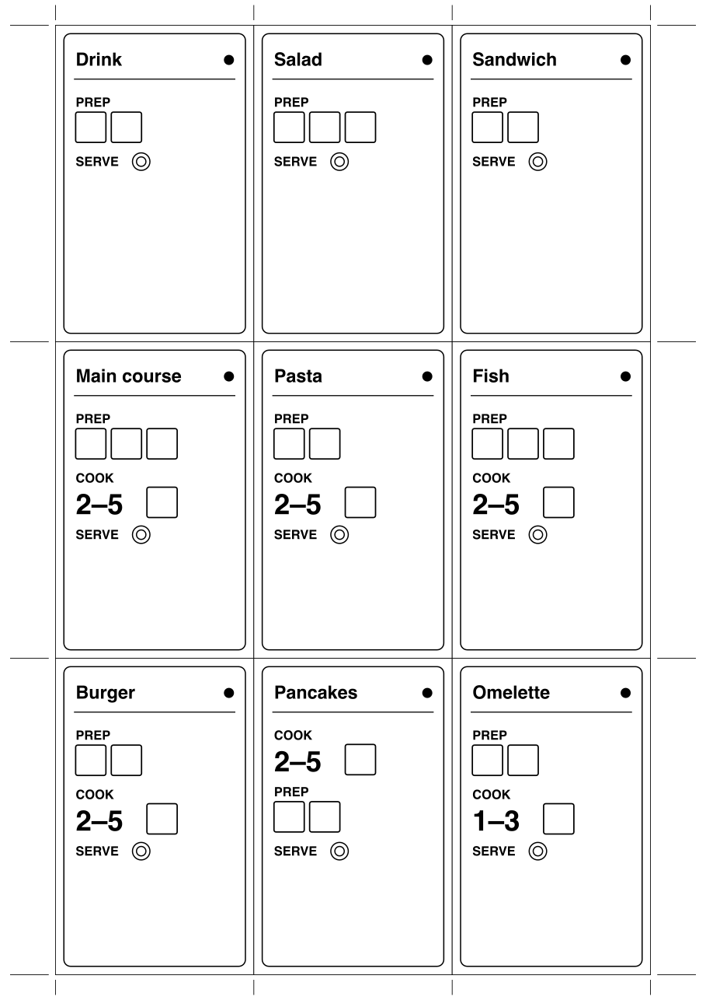
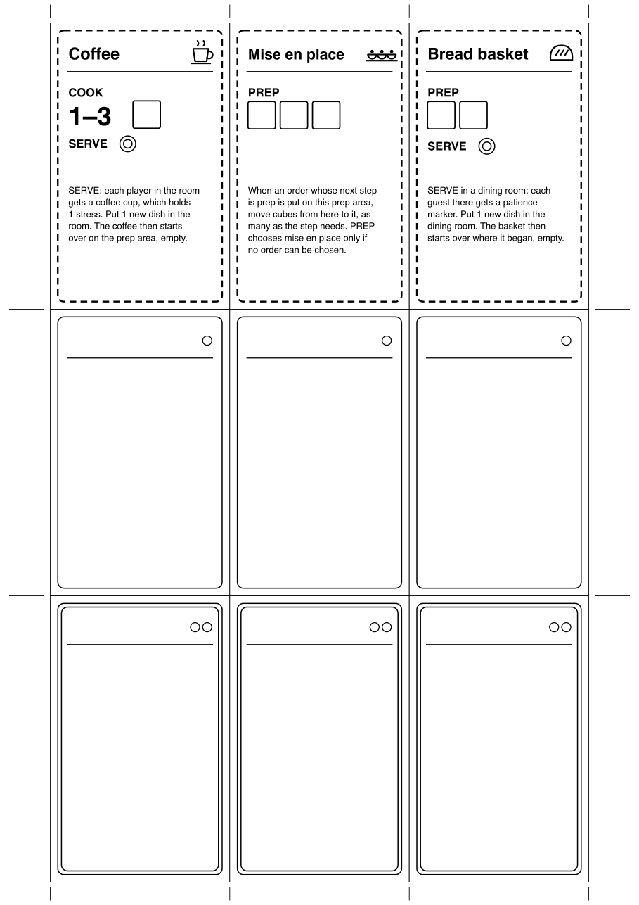

# Kitchen Alert – rules

*Playtest version 2026-10-11*

[Svensk version](regler.md)

Kitchen Alert is a cooperative game built on Space Alert. Four players, or five, run a restaurant during a service. As in Space Alert, you plan in real time to a soundtrack and then play out the plan round by round. Instead of threats, orders come in, and instead of damage you take stress.

These rules assume you know Space Alert. Anything that works the same way is described only briefly.

## Components

- The board: [`print/board.pdf`](print/board.pdf), A3.
- Order cards: 12 regular and 6 large, [`print/order-cards-1.pdf`](print/order-cards-1.pdf) and [`print/order-cards-2.pdf`](print/order-cards-2.pdf). Cut them out and put them in sleeves in front of Space Alert threat cards.
- Special cards, and blank cards for your own orders: [`print/special-cards.pdf`](print/special-cards.pdf).
- Action cards, player boards and figures from Space Alert (see [The deck](#the-deck)).
- Markers for each round 1–8, numbered with the round:
  - 1 card tag, which lies on the order card. It needs no back.
  - 1 order marker, which shows where the order is. Dish on the back.
  - 1 guest marker, which moves on the guest track. Dish on the back.
  - 3 focus markers, which go on action cards. Dish on the back.

  The markers are easier to tell apart if the kinds look different, for example in shape or colour. The board is drawn for markers of about 20 mm.
- 8 loose dish tokens.
- Prep cubes (about 20) and stress cubes in another colour (about 20).
- Patience markers, about 10.
- 3 overflow spaces per player, for example three boxes on a slip of paper next to the player board.
- With special cards: a marker for each special card and some coffee cups.
- The service player (see [The service player](#the-service-player)) or a printed service.

## The board

The board has four rooms. The dining rooms are in the north and the kitchens in the south. The red side is on the left and the blue side on the right, like the zones in Space Alert:

| | Red side | Blue side |
| --- | --- | --- |
| North | Red dining room | Blue dining room |
| South | Hot kitchen | Cold kitchen |

The board has no words. This is how to read it:

- **Doors:** one between the dining rooms, one between the kitchens, and one between the kitchen and the dining room on each side.
- **The hatch** on each side lies across the wall between the kitchen and the dining room and belongs to both rooms. **The bar counter** lies across the wall between the dining rooms and belongs to both dining rooms.
- **Spots:** each single circle holds one order marker or one stack of dishes. The prep areas, the hatches and the bar counter have two spots each. Each dining room has a table with one spot.
- **Dish spots:** double rings hold dishes only. The dishwasher in the cold kitchen has two stacks. The sink in the hot kitchen and the bar sink in each dining room have one stack.
- **Drop:** you can wash dishes here. With a 1 next to the drop, CLEAN washes 1 dish; otherwise it washes all of them.
- **The stove** in each kitchen has two tracks, one per burner. The numbers are the stove's heat, and B means burnt. The hot kitchen has the fast stove and the cold kitchen the slow one.
- **The guest track** in each dining room has spaces 1–7. A lightning bolt is 1 stress, and the arrow out through the wall means that the guest leaves.
- **Station symbols** sit above the prep areas. The cube with a number is the number of cubes per PREP, » means spill-over, and the plate +1 means 1 new dish per PREP.
- **Flame and snowflake** show which kitchen is hot and which is cold.

## The order cards

Each order has its steps from top to bottom. PREP has one box per cube it needs. COOK has a heat range and a box for the cube that shows the cooking is done. STIR means that someone has to stir, and also has a box for a cube. SERVE comes last. A regular order has one dot and a single frame; a large order has two dots and a double frame. An hourglass at the bottom means that the guest gets a patience marker when the order comes in. Each large order has one hourglass.

## Setup

1. Lay out the board and put all figures in the cold kitchen.
2. Shuffle the regular and the large order cards into separate decks.
3. If you like, put one or two special cards next to a kitchen, with their markers on the prep area there (see [Special cards](#special-cards)).
4. Shuffle the action cards. Each player draws 5 cards for the first phase.
5. Sort the markers by number. Put the dish tokens, prep cubes, stress cubes and patience markers in the supply.
6. Start a service in the service player.

## Planning

Planning works as in Space Alert. You put cards on your boards in real time while the soundtrack plays. Each card is used either as an action or as a move. A round without a card is a break. When a new phase begins, each player draws 5 cards, and leftover cards are kept.

The soundtrack announces:

- **Orders**, for example *Time T plus three. New order. Red dining room.* The team decides who draws the top card of the right deck: *New order* is a regular order and *Large order* a large one. That player puts the round's guest marker on space 1 of the guest track in the dining room that was announced. Then the player puts the order card next to one of the four rooms, where the order starts, with the round's card tag on it, and takes the round's focus markers. The player holding the order card may not place or move action cards until the card lies next to a room, and the card may not be moved afterwards. The order marker goes on the prep area when the order comes in, but you are welcome to put it there already.
- **Delivery:** each player may draw one card.
- **Handover:** each player may give one card to another player before the beep.
- **Rush hour:** nobody may talk until *Rush is over*.
- **End of phase**, as in Space Alert. The last phase ends with *The kitchen is closed*.

### Markers on cards

A player who has a focus marker can put it on a card on their own board or give it to another player. A player holding a marker in their hand may not place or move cards until the marker lies on one of their own cards in the current phase or has been handed back.

A marker on a card changes the card like this:

| Card | Order side up | Dish side up |
| --- | --- | --- |
| PREP | Choose that order. | No effect. |
| COOK/SERVE | Choose that order. | No effect. |
| MOVE | Carry the order. | Carry dishes. |
| CLEAN | No effect. | No effect. |

## Resolution

When the last phase is over, rounds 1–12 are played out one at a time. Each round has five steps:

1. **New orders.** If an order arrives this round, it comes in. Put its order marker on the prep area of the room where the order card lies, if it is not there already, and put one patience marker on the guest marker for each hourglass on the order card.
2. **Actions.** Each player performs the action on their card for the round, in player order.
3. **Stoves.** Each order on a stove moves one space.
4. **Guests.** Each guest marker moves one space.
5. **Stress.** The stress in each room is handed out.

### Orders

- An order *is in* a room when its order marker lies on an area that belongs to the room. An order in a hatch is therefore in both the kitchen and the dining room.
- A step is *done* when it has all its cubes. The order's *next step* is the first step that is not done.
- When an action could choose between several orders, it chooses the one with the lowest number. A focus marker on the card, order side up, chooses that order instead, if it can be chosen.
- **Full of orders:** if an order must be put on an area where every spot holds an order, it is put there anyway, as an extra order. This costs 1 stress.

### PREP

Choose an order in the room whose next step is prep. An order on a stove can be chosen only if it is ready. If there is no such order, nothing happens.

1. Move the order to the room's prep area.
2. Put cubes on the step: 3 in the cold kitchen, 2 in the hot kitchen and 1 in a dining room. Never put more than the step needs. When the step has all its cubes, it is done.
3. In the cold kitchen only: cubes left over go to the next order in the room that can be chosen, in the same way.
4. In the cold kitchen and in the dining rooms: put 1 new dish in the room.

### COOK/SERVE

Choose an order in the room that one of the following applies to, and do what it says:

- **Ready on the stove:** lift the order off. If the next step is prep, put the order on the prep area. If it is serving, do as for serving below.
- **To be stirred:** the next step is STIR. Put a cube on STIR, and then do what the step after it says. If that is cooking, put the order on the first space of a burner: the same burner if it is already on the stove, otherwise a free one. If it is prep, put the order on the prep area, and if it is serving, do as for serving below.
- **To be cooked:** the order lies on the prep area in a kitchen, its next step is cooking, and a burner is free. Put the order on the first space of the stove.
- **To be served, and the guest is here:** put the order on the table. If there are dishes on the table, move them as new dishes in the dining room; this costs 1 stress. Then flip the order marker and the guest marker, which are now two dishes in a stack on the table. Put the order card with the served ones.
- **To be served, and the guest is elsewhere:** move the order one serving area towards the guest. From a kitchen it goes to the hatch on the same side, and from a dining room to the bar counter. An order that already lies on that area cannot be chosen.

If there is no such order and you are in a dining room, you calm the guest with the lowest number there: put a patience marker on that guest marker. Otherwise nothing happens.

With a focus marker on the card, you can also choose an order on the stove that is not ready. It is moved to the prep area without a cube.

### CLEAN

- **Kitchen:** fill the dishwasher in the cold kitchen, or the sink in the hot kitchen, with dishes from the room's other spots, most disruptive first. Then remove all dishes in the dishwasher or the sink.
- **Dining room:** fill the bar sink with dishes from the room's other spots, most disruptive first. Then remove 1 dish from the bar sink.

Removed dishes go back: loose dish tokens to the supply and markers to their pile.

### Dishes

- A stack holds 3 dishes. The dishwasher therefore holds 6, and the sink and the bar sink 3 each.
- Each room has its spots in a fixed order, from least to most disruptive:
  - Kitchen: dishwasher or sink, hatch, prep area, stove.
  - Dining room: bar sink, hatch, prep area, table. The bar counter takes orders only.
- **A new dish** goes on the first spot in the room's order that has room: a stack with fewer than 3 dishes, or an empty spot. If it fits nowhere, it gives 1 stress and goes back.
- **Dishes in the way:** if an order must be put on an area where every spot is taken and at least one spot holds dishes, move the smallest stack from there as new dishes, but not to the same area. This costs 1 stress.
- Dishes never move by themselves.
- Dishes from PREP are taken from the supply of loose dish tokens. All other dishes are flipped markers.

### Stoves

- Each kitchen has two burners, one per track. An order on the stove lies on a space of one of the tracks.
- In step 3, each order on a stove moves one space along its track.
- When the order reaches a space within the range of its cooking step, put a cube on the step, and the order is *ready*. If the order is put on a space already within the range, the cube goes on at once.
- A ready order stays on the stove until an action lifts it off or stirs it.
- If the order passes the range of the cooking step it is on the stove for, it is scorched: 1 stress in the room. It can still be lifted off and served.
- A COOK step is never directly followed by another one. STIR comes between them, so that it is always clear which cooking step is under way.
- If the order reaches B, it is ruined: 2 stress in the room. Flip the order marker and put it as a new dish in the room. Remove the guest marker and set the order card aside.

### Guests

- In step 4, each guest marker whose order has come in moves one space. A guest marker with patience markers stays where it is instead, and one of its patience markers is removed.
- Spaces 5 and 6 give 1 stress each in the guest's dining room.
- On space 7 the guest leaves: 2 stress in the guest's dining room. Remove the guest marker and set the order card aside. Flip the order marker and put it as a new dish in the room where it lay.
- An order that has not been served after round 12 gives no stress.

### Stress

1. In step 5, stress in empty rooms spreads first: each stress cube in a room where nobody is gets replaced by one stress cube in each of the two neighbouring rooms.
2. Then the stress in each room is handed out to the players there, one cube at a time in player order, until it is gone.
3. Stress still lying in an empty room stays there and spreads again next round. Stress still left after round 12 is handed out to all players, one cube at a time in player order.
4. A cube you get goes on your earliest break that does not have a cube yet. A break is a run of one or more rounds without a card, up to and including this round.
5. If you have no such break, the cube goes in your coffee cup if you have an empty one (see [Special cards](#special-cards)), and otherwise on one of your 3 overflow spaces.
6. If a player must place a cube when all three of their overflow spaces are full, the team loses.

If the team gets through round 12, the service is a success. Count the served orders as well, so that groups can be compared.

### Moving and carrying

- MOVE takes you to a neighbouring room. A horizontal move switches sides, between red and blue. A vertical move switches between kitchen and dining room.
- **MOVE with a focus marker, order side up:** the order must be in the room you leave. Take it with you and put it in the new room:
  - If the order is on a stove and not ready, the cooking continues. Put the order on a free burner, on the space with the highest number that is not higher than the one it left, or on the first space if no number is that low. For example, from 5 in the hot kitchen it ends up on 4 in the cold kitchen. If there is no free burner, or no stove, put it on the prep area, and the cooking starts over.
  - If the next step is prep or STIR, put the order on the prep area.
  - If the next step is cooking, put it on the first space of the stove if a burner is free, and otherwise on the prep area.
  - If the next step is serving, serve it if the guest is in the new room, and otherwise put it on the serving area nearest the guest.
- **MOVE with a focus marker, dish side up:** take up to 6 dishes, two stacks, from the room's spots, most disruptive first. Put them as new dishes in the new room.
- **Collisions:** two moves in the same round collide if they go between the same two rooms, in either direction. Each player in the collision who carries something gets 1 stress at once. A player who carries nothing never collides.

## Special cards

Special cards are things you can always do, whichever orders come in. During setup, put one or two next to a kitchen, with their markers on the prep area there. The marker takes up a spot like an order. Actions choose a special card like an order, but only if no real order in the room can be chosen. Special cards cannot be carried.

- **Coffee:** COOK 1–3 and SERVE. The coffee is served in the room where it is: each player there gets a coffee cup, unless they already have an empty one. Put 1 new dish in the room. The coffee then starts over on the prep area, without cubes. A coffee cup holds 1 stress, which goes there when the player has no free break (see [Stress](#stress)).
- **Mise en place:** PREP 3. When an order whose next step is prep is put on the prep area in the room, move cubes from the mise en place to it, as many as the step needs. The cubes stay until then. The cold kitchen's spill-over can go here, but only when no order can take it.
- **Bread basket:** PREP 2 and SERVE. The bread basket is served in the first dining room it reaches: COOK/SERVE in the kitchen moves it to the hatch, and COOK/SERVE in the dining room serves it. Then each guest in that dining room gets a patience marker. Put 1 new dish in the dining room. The basket then starts over on the prep area where it began, without cubes.

The sheet of special cards also has blank cards for your own orders.

## The deck

Space Alert's action cards serve as the deck:

- All 30 A cards are COOK/SERVE.
- All 21 C cards are PREP.
- 15 B cards are CLEAN: take five with each kind of arrow.
- Red and blue arrows are horizontal moves, and the lift is a vertical move.

Set aside the battlebot cards and the heroic action cards. 66 cards are enough for four players, who draw 60 between them. Five players need 75; then 9 battlebot cards can be used as COOK/SERVE, but this is untested.

## Difficulty

The service player has three sizes. Five players get one more order point.

| Size | Order points, four players | Orders |
| --- | --- | --- |
| Easy | 6 | 4 regular and 1 large |
| Normal | 7 | 5 regular and 1 large |
| Hard | 8 | 6 regular and 1 large, or 4 regular and 2 large |

A regular order is worth 1 point and a large order 2. Start with *First service (easy)*.

## The service player

The service player needs Python 3. Start it with `python3 server.py` in the top folder of the repository and open <http://localhost:8000/kitchen.htm>. Choose the number of players and a service:

- *New service* generates a new service.
- The fixed services, *First service*, *Service 1–3* and *Busy night*, are the same for every group.

The screen shows the order with one or two plates, a floor plan where the guest's dining room lights up in its colour, and the round. After the service, *Show script* shows everything that was announced.

Without a computer, someone can read a service aloud. `python3 kitchenalert/kitchenalert.py -p 4 -s normal` prints a new one.

## Variants to try

- **Directional arrows:** a red arrow goes to the red side and a blue arrow to the blue side, as in Space Alert. An arrow towards the side you are already on does nothing.
- **Deck by letter:** the A cards (30) are PREP, the B cards (15 of 24) CLEAN and the C cards (21) COOK/SERVE. COOK/SERVE then becomes the rarest card, so more orders are served by carrying them with a focus marker. That means more moves and more collisions.
